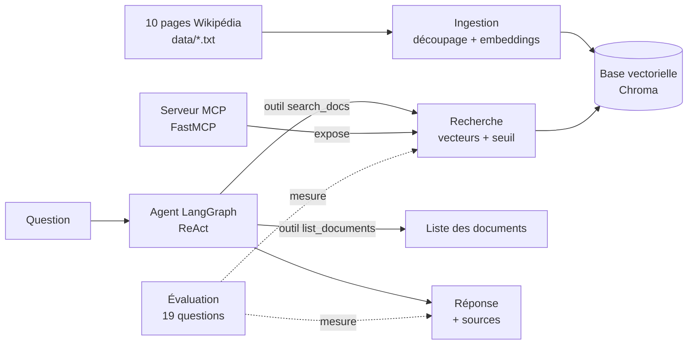

# ATM-Assist

**Assistant agentique de recherche documentaire sur la gestion du trafic aérien** : RAG, agent LangGraph, serveur MCP (FastMCP) et évaluation chiffrée.

Projet personnel réalisé en deux jours pour comprendre, de bout en bout, comment passer d'un prototype d'IA à un système **testé, mesuré et documenté**. Il reprend les briques d'un système agentique : agent et outils, base de connaissances avec embeddings, connecteur MCP, évaluation de la qualité.

---

## Ce que fait le projet

On pose une question en langage naturel (« Quel est le rôle d'Eurocontrol ? »). L'assistant retrouve les passages pertinents dans une petite base de documents publics, répond **uniquement à partir de ces passages** en citant ses sources, et **refuse de répondre** quand les documents ne contiennent pas l'information.

## Architecture



| Brique | Détail |
|---|---|
| Corpus | 10 pages Wikipédia FR sur le contrôle aérien, les radars, l'ADS-B, Eurocontrol, etc. |
| Découpage | Passages d'environ 500 caractères, chevauchement de 50 |
| Embeddings | `paraphrase-multilingual-MiniLM-L12-v2` (local, gratuit) |
| Base vectorielle | Chroma (stockage persistant) |
| Recherche | Similarité cosinus ; option hybride BM25 + vecteurs (fusion RRF) |
| Garde-fous | Seuil de pertinence (0,40) puis consigne « répondre uniquement à partir des extraits » |
| LLM | Modèles gratuits via OpenRouter (API compatible OpenAI) |
| Agent | LangGraph (`create_agent`, schéma ReAct), 2 outils, limite de 12 étapes |
| MCP | Serveur FastMCP : outils `search_docs` et `list_documents`, journal d'appels |
| Tests | 16 tests `pytest` |

## Installation

Testé sous Windows, Python 3.11.

```
python -m venv .venv
.venv\Scripts\Activate.ps1
pip install -r requirements.txt
```

Crée un fichier `.env` à la racine (jamais versionné) avec ma clé OpenRouter :

```
OPENROUTER_API_KEY=ma_cle
```

## Utilisation

```
python src/download_corpus.py     # télécharge les documents dans data/
python src/ingest.py              # découpe, calcule les embeddings, remplit la base
python src/search.py "Qu'est-ce qu'un transpondeur ?"   # recherche seule
python src/rag.py "Quel est le rôle d'Eurocontrol ?"    # RAG simple
python src/agent.py "Compare le radar secondaire et l'ADS-B"   # agent
python src/test_mcp.py            # teste le serveur MCP avec un client
python src/mcp_server.py          # lance le serveur MCP (stdio)
```

Évaluation et tests :

```
python eval/eval_retrieval.py vecteur      # qualité de la recherche (gratuit)
python eval/eval_retrieval.py hybride
python eval/eval_generation.py             # compare 2 modèles (appels OpenRouter, mis en cache)
python eval/inspecter.py                   # affiche les réponses suspectes du cache
pytest -q
```

## Exemple

```
> python src/agent.py "Compare le radar secondaire et l'ADS-B"

  → outil appelé : search_docs("Compare le radar secondaire et l'ADS-B")
  → outil appelé : search_docs("radar secondaire transpondeur fonctionnement principe 1030 MHz 1090 MHz")
  → outil appelé : search_docs("ADS-B fonctionnement principe GPS position automatique ...")

Le radar secondaire fonctionne par interrogation : le sol émet sur 1 030 MHz et le
transpondeur répond sur 1 090 MHz (source : radar_secondaire.txt). L'ADS-B est un système
de diffusion autonome : l'avion calcule sa position par GNSS et la diffuse périodiquement
(source : ads_b.txt). [...]
```

L'agent a décidé seul de **reformuler** sa recherche en plusieurs requêtes ciblées. Pour une question hors sujet (« Quelle est la capitale du Japon ? »), il refuse de répondre.

---

## Évaluation

### Méthode
- **19 questions** (`eval/questions.json`) : 14 sur le corpus (avec le ou les fichiers attendus) et 5 hors corpus.
- **Recherche** : hit@k (le bon document est-il dans les k premiers résultats ?), MRR, et une mesure **au niveau du passage** (un passage retrouvé contient-il réellement la réponse ?) sur 4 questions avec un mot-clé de réponse.
- **Réponses** : 2 modèles gratuits aux identifiants fixés (`recursive/flint-v1.0:free` et `nvidia/nemotron-3.5-super-vl:free`) ; mesures automatiques : refus, citations, nombres non fondés (un nombre de la réponse absent des passages fournis), latence. Réponses mises en cache pour ne jamais redemander un appel déjà réussi.

### Résultats : recherche vectorielle (configuration retenue)

| Mesure | Résultat |
|---|---|
| hit@1 / hit@3 / hit@5 (document) | 93 % / 100 % / 100 % |
| MRR | 0,95 |
| Passage hit@5 (4 questions) | 75 % |
| Scores des questions hors corpus | de 0,24 à 0,34, sauf une à 0,54 |
| Score le plus bas d'une question du corpus | 0,53 |

Les scores des deux groupes se chevauchent légèrement : aucun seuil ne les sépare parfaitement. J'ai retenu **0,40** : il écarte 4 questions hors corpus sur 5 et conserve les 14 questions du corpus. Un refus à tort étant plus gênant qu'un passage douteux transmis, le seuil est plus proche des scores hors corpus ; la dernière question hors corpus est rattrapée par la consigne donnée au LLM.

### Résultats : comparaison de deux modèles (19 questions)

| Modèle | Faux refus | Refus corrects (hors corpus) | Réponses citées | Nombres non fondés | Latence médiane |
|---|---|---|---|---|---|
| `recursive/flint-v1.0:free` | 1 | 5/5 | 13/14 | 0/14 | 5,2 s |
| `nvidia/nemotron-3.5-super-vl:free` | 1 | 5/5 | 13/14 | 0/14 | 4,0 s |

**Aucune différence de qualité détectable** entre les deux modèles sur ces mesures. L'écart de latence est trop fragile pour conclure (une seule passe, réessais inclus, serveurs gratuits variables). Les 4 questions clairement hors sujet sont refusées par le seuil **sans appel au LLM** ; la cinquième (« batterie de voiture électrique », score 0,54) passe le seuil mais est bien refusée par les deux modèles : le garde-fou à deux niveaux fonctionne.

### Un échec analysé : « Combien de pistes possède l'aéroport de Paris-CDG ? »
Les deux modèles ont refusé de répondre, alors que le document contient « quatre pistes ». Diagnostic :
- Les modèles ont eu raison : **le contexte reçu ne contenait pas la réponse**. C'est un échec de la **recherche**, pas des modèles.
- Mon évaluation au niveau du document ne le voyait pas : les 10 meilleurs passages venaient tous du bon fichier, mais aucun ne contenait « pistes ». Le premier passage contenant « quatre pistes » est au **rang 12**. J'ai donc ajouté une mesure au niveau du passage.
- La recherche par le sens retrouve le *sujet* (l'aéroport), mais distingue mal une information précise au sein d'un même document long.
- L'agent a reformulé sa requête deux fois sans réussir.

### Une amélioration testée : recherche hybride (BM25 + vecteurs)
Hypothèse : la recherche par mots exacts remontera le passage contenant « pistes ». Résultat mesuré :

| Mode | hit@1 | MRR | Passage hit@5 |
|---|---|---|---|
| Vecteurs seuls | 93 % | 0,95 | 75 % |
| Hybride (RRF) | 86 % | 0,93 | 75 % |

**Pas d'amélioration** : la question sur les pistes reste en échec (le passage reste au rang 12) et une autre question se dégrade légèrement. La configuration par défaut reste donc la recherche vectorielle ; le mode hybride est conservé en option (`RECHERCHE_HYBRIDE` dans `src/config.py`).

## Limites
- Échantillon réduit : 19 questions et 4 mots-clés de réponse ; les pourcentages sont indicatifs. Le seuil de 0,40 est calibré sur cet échantillon.
- Les mesures automatiques ne jugent pas si une réponse est **juste**, seulement si elle est fidèle, citée et bien refusée. La détection du refus repose sur quelques expressions et se vérifie à la main.
- Un seul passage de mesure par modèle ; les modèles gratuits ont des quotas et des disponibilités variables (réponses vides possibles, gérées par des réessais).
- Corpus limité à 10 pages Wikipédia, susceptibles d'être incomplètes ou datées.
- L'agent peut refuser une question hors sujet **sans appeler l'outil de recherche**, en s'appuyant sur son prompt.

## Pistes d'amélioration
- Tester des passages plus courts ou une autre stratégie de découpage, puis remesurer.
- Étendre le jeu de questions et les mots-clés de réponse.
- Ajouter un LLM comme juge sur un échantillon pour estimer l'exactitude.
- Faire consommer le serveur MCP par l'agent (adaptateur MCP pour LangChain).
- Conteneuriser (Docker) et ajouter une intégration continue.

## Journal de bord : problèmes rencontrés et solutions

| Problème | Cause | Solution |
|---|---|---|
| Clé API visible dans du code | Clé écrite en clair dans des scripts | Clé révoquée, nouvelle clé dans `.env`, `.env` dans `.gitignore` avant le premier commit |
| Scripts introuvables, caractère `&` dans un chemin | Terminal lancé dans le mauvais dossier, chemin avec caractère spécial | Dossier de travail simple, terminal ouvert dedans |
| Réponses vides de certains modèles gratuits | Modèles qui « réfléchissent » et épuisent leur budget de tokens | `max_tokens` augmenté, réessais automatiques, nom du modèle affiché |
| Le modèle répond à une question hors sujet | La recherche renvoie toujours des passages, même hors sujet | Seuil de pertinence (0,40) + consigne de refus dans le prompt |
| Comparaison de modèles non reproductible | Le routeur gratuit change de modèle d'un appel à l'autre | Identifiants de modèles fixés pour l'évaluation |
| Évaluation trop optimiste | hit@k au niveau du document masquait un échec de recherche | Mesure au niveau du passage (mot-clé de la réponse) |
| Recherche hybride sans gain | Hypothèse non confirmée sur mon corpus | Résultat documenté, configuration par défaut inchangée |

## Structure du dépôt

```
data/     documents du corpus (texte brut, URL de la source en première ligne)
src/      ingestion, recherche, RAG, agent, serveur MCP, configuration
eval/     questions, scripts d'évaluation, résultats et cache
tests/    tests pytest
```

## Licences et données
Les textes du corpus proviennent de Wikipédia (licence CC BY-SA 4.0) ; l'URL de chaque article est indiquée en tête du fichier correspondant. Le code est fourni à titre d'illustration.
